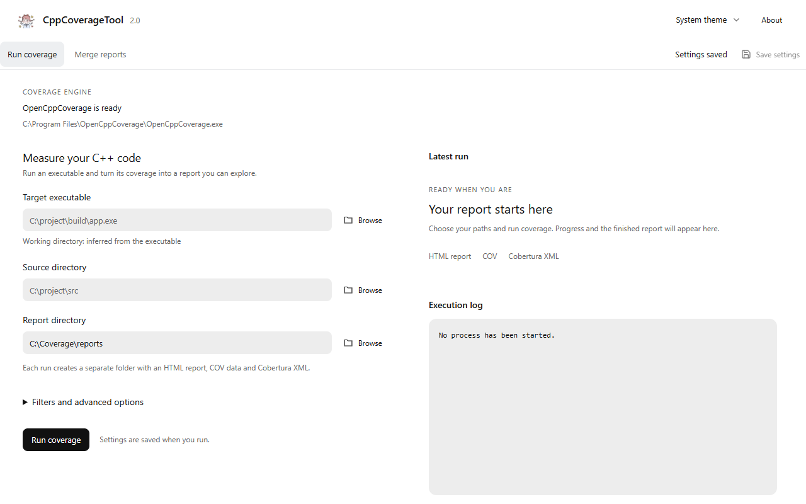
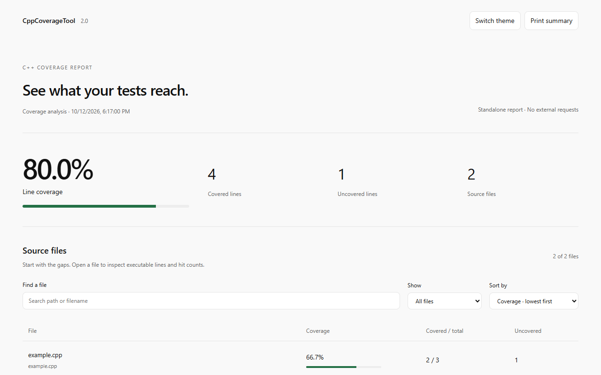

# CppCoverageTool

A local web workspace for Windows C++ code coverage, powered by [OpenCppCoverage](https://github.com/OpenCppCoverage/OpenCppCoverage).

Version **2.0.0** replaces the Qt application with a React interface and a small Node.js service. The interface uses [ChatGPT Desktop UI](https://github.com/liuminxin45/ChatGPT-Desktop-UI), pinned to an immutable Git revision. Coverage runs on your computer; source code and reports are never uploaded by this application.

## What it does

- Detects OpenCppCoverage in PATH or its standard Program Files directory.
- Runs an executable with source/module filters, optional PDB path substitution and target arguments.
- Merges `.cov` files recursively while excluding the report output directory.
- Saves local configuration and streams a bounded execution log.
- Stops a running coverage process and its child processes.
- Generates a custom, standalone HTML report from Cobertura XML, alongside binary COV data.

The report includes overall line coverage, file sorting and search, uncovered-file filters, source snapshots, per-line hit counts, next-uncovered-line navigation, light/dark themes and a printable summary. It works offline without external scripts, fonts or services. OpenCppCoverage's HTML exporter is replaced by a post-run report pipeline; the upstream executable is not modified.





## Requirements

- Windows 10 or later and a current Edge, Chrome or Firefox browser.
- Node.js 22.23.3+ (22.x) or 24.19.0+ (24.x), matching the UI library's supported runtime.
- OpenCppCoverage, installed separately and added to PATH (the standard installation directory is also detected).
- Target executables built with matching PDB files. Matching local source files are needed for source snapshots.
- Git and npm when building from source. Qt, CMake and Visual Studio are not required to build the interface.

## Start from the release package

Download and extract `CppCoverageTool-2.0.0-windows.zip` from [Releases](https://github.com/liuminxin45/CppCoverageTool/releases). Install Node.js and OpenCppCoverage, then double-click `start.cmd`.

The package contains the prebuilt interface and backend dependencies. No npm installation or compiler is needed. Node.js and OpenCppCoverage binaries are not bundled.

Keep the service window open while using the application. Close it with Ctrl+C when finished. The service listens only on `http://127.0.0.1:47831`; use `PORT` to select another port if needed. An occupied port is reported as an error rather than connecting to another service.

## Build from source

```powershell
npm ci
npm run check:ui
npm test
npm run build
npm start
```

Or run `./build.ps1 -Package` to validate and create a release ZIP. Git dependency preparation must be enabled; do not install with `--ignore-scripts`. If your npm version requires lifecycle approval, approve only `chatgpt-desktop-kit` and `esbuild` before installation.

For frontend development, run `node server/index.mjs --dev` and `npm run dev` in separate terminals. Open the Vite URL. Development-only origin support is enabled explicitly by `--dev`.

## Run coverage

1. Choose the target executable and source directory. Its parent directory becomes the working directory.
2. Choose a report output directory. Every run creates a unique subdirectory, preserving earlier reports.
3. Expand **Filters and advanced options** if needed. By default, module filtering selects the executable; add DLL names or patterns to include your libraries.
4. Click **Run coverage**. Configuration is saved before execution.
5. After completion, click **Open report** or **Open folder**.

Paths can be typed or selected with native Windows dialogs. The optional PDB prefix maps the original build-time source prefix to your selected source directory.

Target arguments are a JSON array of strings, for example `["--test", "a path with spaces"]`. Arguments are passed directly without shell interpretation. Additional coverage filters use the same array format and support `--excluded_modules`, `--excluded_line_regex`, `--continue_after_cpp_exception` and `--no_aggregate_by_file`. Execution, working-directory and export options are managed by the application.

## Merge reports

Select **Merge reports**, choose an input directory containing `.cov` files and an output directory. Subdirectories are scanned; generated output and symbolic links/junctions are excluded. The input directory cannot be inside the output directory. Up to 1,000 inputs are supported, subject to Windows command-length limits.

The optional source directory enables source snapshots in the merged report. Without readable, matching sources, executable line numbers and hit counts remain available.

## Output and local data

Each successful run produces:

```text
coverage-<timestamp>-<id>/    # or merge-<timestamp>-<id>
  html/index.html           # standalone custom report
  coverage.cov              # merged.cov for a merge
  coverage.xml              # merged.xml for a merge
```

Settings are stored at `%LOCALAPPDATA%\CppCoverageTool\settings.json`. Save explicitly with **Save settings**, or run a workflow to save its configuration. Invalid saves preserve your draft. Unreadable existing settings are preserved and a recovery notice is shown. Legacy Qt registry settings are not imported; configure your paths once after upgrading.

The interface retains the latest run for the current service session and the latest 256 KB of process output. Existing reports remain on disk after restarting the service. A nonzero process exit, cancellation or report-generation error is shown as such; partial COV/XML output remains available in the report folder.

HTML reports can embed your source code and local filenames. Review their contents before sharing. Source snapshots are restricted to the configured source directory and capped at 2 MB per file / 20 MB overall. The report measures executable **line coverage**, not branch coverage. An XML limit of 64 MB bounds report generation.

## Validation

```powershell
npm test
npm run test:browser
npm run check:ui
npm run build
npm run package
npm run test:package
```

Browser checks use installed Microsoft Edge by default; set `COVERAGE_BROWSER=chrome` to use Chrome. To run against Playwright's Chromium, install it with `npx playwright install chromium` and set `COVERAGE_BROWSER=chromium`.

The optional real-engine integration test needs a compiled copy of `tests/fixture.cpp` with debug information. Set `COVERAGE_TEST_EXE` to its absolute `.exe` path and run `npm test`. It verifies complementary coverage runs, binary merge, source snapshots and process cancellation. Without that variable, only the real-engine test is skipped.

See [the 2.0 review and validation record](docs/REVIEW.md) for the audited behavior, rendered surfaces and remaining limits.

## License

MIT. Third-party dependencies retain their own licenses; see [THIRD_PARTY_NOTICES.md](THIRD_PARTY_NOTICES.md).
