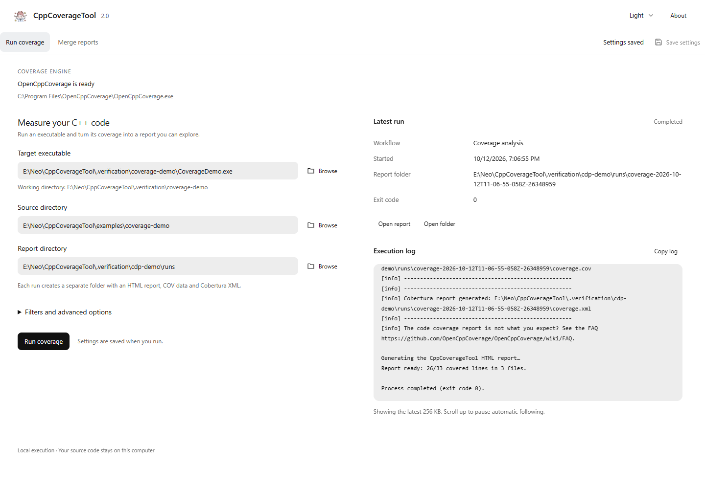
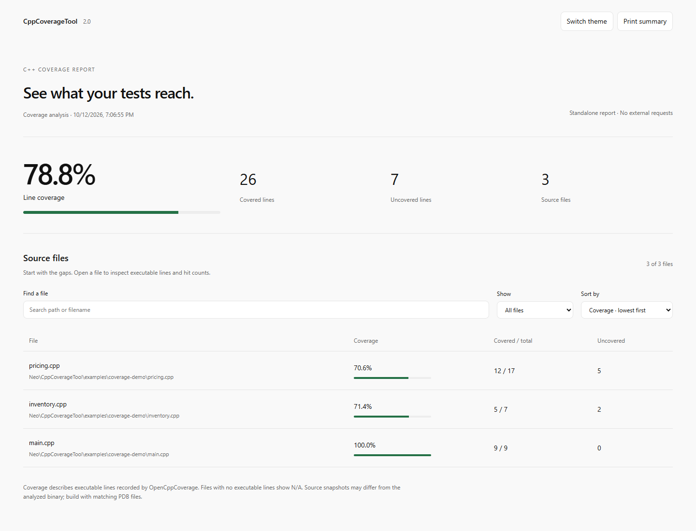
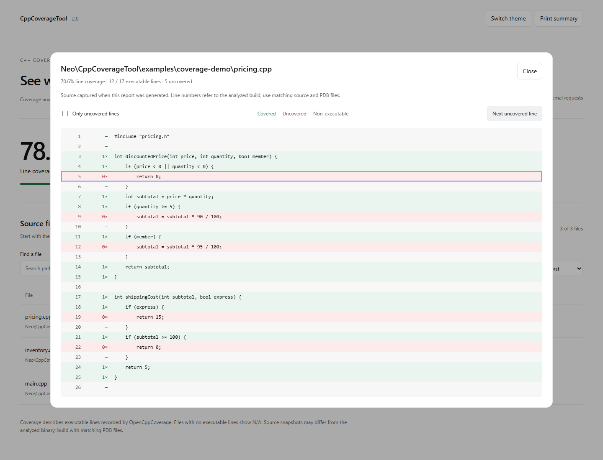
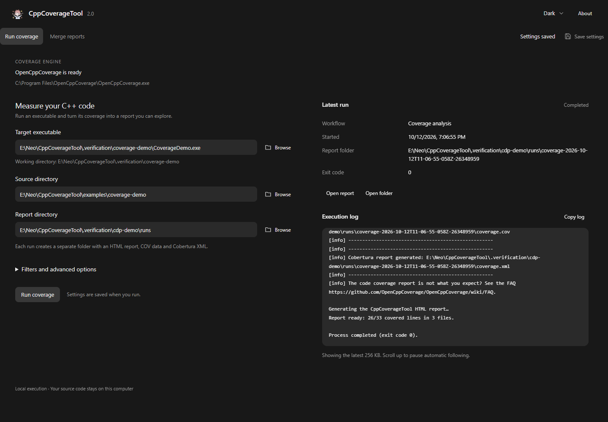
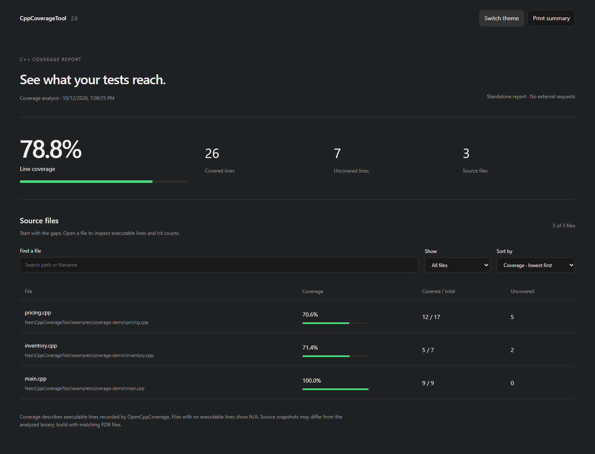
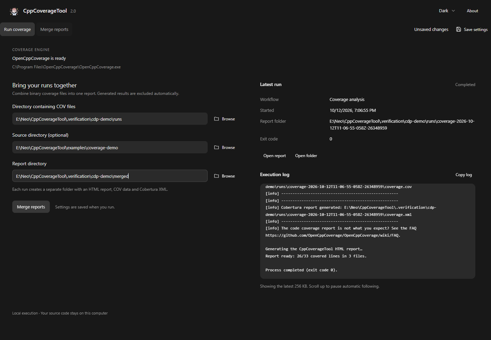

# CppCoverageTool

A local web workspace for Windows C++ code coverage, powered by [OpenCppCoverage](https://github.com/OpenCppCoverage/OpenCppCoverage).

Version **2.0.1** replaces the Qt application with a React interface and a small Node.js service. The interface uses [ChatGPT Desktop UI](https://github.com/liuminxin45/ChatGPT-Desktop-UI), pinned to an immutable Git revision. Coverage runs on your computer; source code and reports are never uploaded by this application.

## What it does

- Detects OpenCppCoverage in PATH or its standard Program Files directory.
- Runs an executable with source/module filters, optional PDB path substitution and target arguments.
- Merges `.cov` files recursively while excluding the report output directory.
- Saves local configuration and streams a bounded execution log.
- Stops a running coverage process and its child processes.
- Generates a custom, standalone HTML report from Cobertura XML, alongside binary COV data.

The report includes overall line coverage, file sorting and search, uncovered-file filters, source snapshots, per-line hit counts, next-uncovered-line navigation, light/dark themes and a printable summary. It works offline without external scripts, fonts or services. OpenCppCoverage's HTML exporter is replaced by a post-run report pipeline; the upstream executable is not modified.

## Screenshots from a real C++ run

The demo in [examples/coverage-demo](examples/coverage-demo) models pricing, shipping and stock checks. It was compiled with PDB debug information and executed by OpenCppCoverage: **26/33 executable lines covered (78.8%), across 3 source files**. These are actual application/report screenshots, captured through CDP `Page.captureScreenshot` over an isolated Chromium pipe; no desktop automation or mocked coverage data was used.

**Coverage workspace — completed run**



**Standalone HTML report**



**Source detail — uncovered-line navigation**



<details>
<summary>Dark theme and merge workspace</summary>







</details>

## Requirements

- Windows 10 or later and a current Edge, Chrome or Firefox browser.
- Node.js 22.23.3+ (22.x) or 24.19.0+ (24.x) for source/portable usage. The Windows installer includes its own Node.js runtime.
- OpenCppCoverage, installed separately and added to PATH (the standard installation directory is also detected).
- Target executables built with matching PDB files. Matching local source files are needed for source snapshots.
- Git and npm when building from source. Qt, CMake and Visual Studio are not required to build the interface.

## Install on Windows

Run `CppCoverageTool-2.0.1-windows-x64-setup.exe`. The installer installs for your Windows account, bundles a checksum-verified Node.js runtime, adds a Start menu shortcut and registers an uninstall entry in Windows Apps. No Qt, npm installation, administrator access or external Node.js installation is required. Install OpenCppCoverage separately.

**Published local Jenkins release:** [Build #4 — SUCCESS](http://localhost:8080/job/CppCoverageTool-Windows-Release/4/), [download the Windows installer](http://localhost:8080/job/CppCoverageTool-Windows-Release/4/artifact/release/CppCoverageTool-2.0.1-windows-x64-setup.exe), [SHA-256 checksums](http://localhost:8080/job/CppCoverageTool-Windows-Release/4/artifact/release/SHA256SUMS.txt). These links use the local Jenkins controller and require Jenkins access. The archived installer was downloaded and its checksum verified after publication.

The launcher reuses an existing Node.js executable in PATH only if its SHA-256 exactly matches the bundled official runtime; otherwise it uses the bundled copy. This accommodates managed Windows environments that approve network access by executable location.

Launch **CppCoverageTool** from the Start menu. The workspace opens in your browser and a system tray icon keeps the local service available. Use the tray's **Exit** command to stop the service and any active coverage process. Closing the browser tab leaves the service running. Uninstall through Windows Apps; existing settings, reports and untracked user files are preserved.

Installers are unsigned. Download from your trusted Jenkins release build or the project's [Releases](https://github.com/liuminxin45/CppCoverageTool/releases), and verify `SHA256SUMS.txt`.

For the portable option, extract `CppCoverageTool-2.0.1-windows.zip`, install Node.js and OpenCppCoverage, then run `start.cmd`. Keep that service window open and use Ctrl+C when finished. The portable ZIP does not bundle Node.js.

Both variants listen only on `http://127.0.0.1:47831`; use `PORT` to select another port. An occupied port is reported as an error rather than adopting another service.

## Jenkins release

[Jenkinsfile](Jenkinsfile) builds a tagged release on a Windows agent, runs validation and the real demo/CDP capture, builds and tests the installer, then publishes the installer, portable ZIP, SHA-256 checksums and build metadata as fingerprinted Jenkins artifacts. See [Jenkins setup and artifact publishing](docs/JENKINS.md) for the job and agent requirements.

The local release is published by **CppCoverageTool-Windows-Release** on **e-disk-agent**. See [the verified publication record](docs/JENKINS-RELEASE-2.0.1.md). Other Jenkins deployments can configure their own controller and agent using the same pipeline.

## Build from source

```powershell
npm ci
npm run check:ui
npm test
npm run build
npm start
```

Or run `./build.ps1 -Package` to validate and create a release ZIP; use `./build.ps1 -Installer` to build and validate the Windows installer too. Git dependency preparation must be enabled; do not install with `--ignore-scripts`. If your npm version requires lifecycle approval, approve only `chatgpt-desktop-kit` and `esbuild` before installation.

For frontend development, run `node server/index.mjs --dev` and `npm run dev` in separate terminals. Open the Vite URL. Development-only origin support is enabled explicitly by `--dev`.

## Run coverage

1. Choose the target executable and source directory. Its parent directory becomes the working directory.
2. Choose a report output directory. Every run creates a unique subdirectory, preserving earlier reports.
3. Expand **Filters and advanced options** if needed. By default, module filtering selects the executable; add DLL names or patterns to include your libraries.
4. Click **Run coverage**. Configuration is saved before execution.
5. After completion, click **Open report** or **Open folder**.

Paths can be typed or selected with native Windows dialogs. The optional PDB prefix maps the original build-time source prefix to your selected source directory.

Target arguments are a JSON array of strings, for example `["--test", "a path with spaces"]`. Arguments are passed directly without shell interpretation. Additional coverage filters use the same array format and support `--excluded_modules`, `--excluded_line_regex`, `--continue_after_cpp_exception` and `--no_aggregate_by_file`. Execution, working-directory and export options are managed by the application.

## Merge reports

Select **Merge reports**, choose an input directory containing `.cov` files and an output directory. Subdirectories are scanned; generated output and symbolic links/junctions are excluded. The input directory cannot be inside the output directory. Up to 1,000 inputs are supported, subject to Windows command-length limits.

The optional source directory enables source snapshots in the merged report. Without readable, matching sources, executable line numbers and hit counts remain available.

## Output and local data

Each successful run produces:

```text
coverage-<timestamp>-<id>/    # or merge-<timestamp>-<id>
  html/index.html           # standalone custom report
  coverage.cov              # merged.cov for a merge
  coverage.xml              # merged.xml for a merge
```

Settings are stored at `%LOCALAPPDATA%\CppCoverageTool\settings.json`. Save explicitly with **Save settings**, or run a workflow to save its configuration. Invalid saves preserve your draft. Unreadable existing settings are preserved and a recovery notice is shown. Legacy Qt registry settings are not imported; configure your paths once after upgrading.

The interface retains the latest run for the current service session and the latest 256 KB of process output. Existing reports remain on disk after restarting the service. A nonzero process exit, cancellation or report-generation error is shown as such; partial COV/XML output remains available in the report folder.

HTML reports can embed your source code and local filenames. Review their contents before sharing. Source snapshots are restricted to the configured source directory and capped at 2 MB per file / 20 MB overall. The report measures executable **line coverage**, not branch coverage. An XML limit of 64 MB bounds report generation.

## Validation

```powershell
npm test
npm run test:browser
npm run check:ui
npm run build
npm run package
npm run test:package
npm run installer
npm run test:installer
```

Browser checks use installed Microsoft Edge by default; set `COVERAGE_BROWSER=chrome` to use Chrome. To run against Playwright's Chromium, install it with `npx playwright install chromium` and set `COVERAGE_BROWSER=chromium`.

The optional real-engine integration test needs a compiled copy of `tests/fixture.cpp` with debug information. Set `COVERAGE_TEST_EXE` to its absolute `.exe` path and run `npm test`. It verifies complementary coverage runs, binary merge, source snapshots and process cancellation. Without that variable, only the real-engine test is skipped.

To regenerate the real screenshots, run `./scripts/build-demo.ps1` followed by `npm run screenshots:demo`. MSVC and OpenCppCoverage are needed for that demo. The capture script attaches CDP sessions to an isolated Edge process and uses `Page.captureScreenshot` directly.

See [the 2.0 review and validation record](docs/REVIEW.md) for the audited behavior, rendered surfaces and remaining limits.

## License

MIT. Third-party dependencies retain their own licenses; see [THIRD_PARTY_NOTICES.md](THIRD_PARTY_NOTICES.md).
